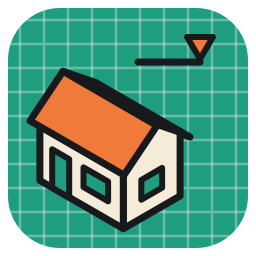
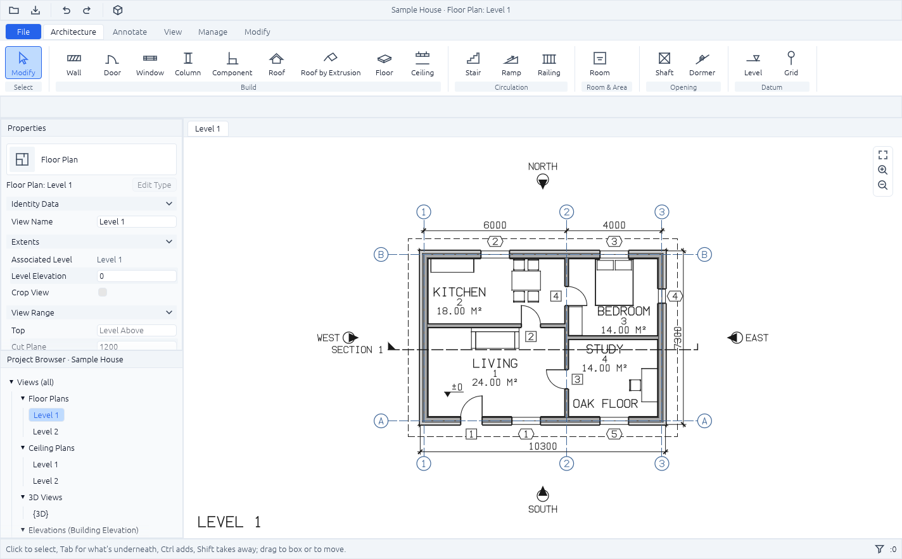
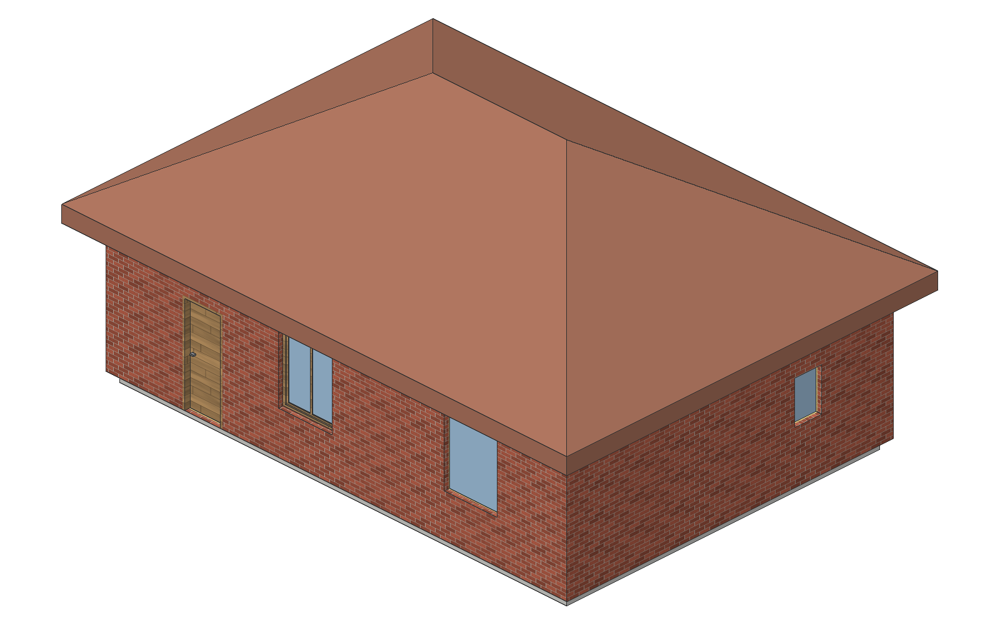
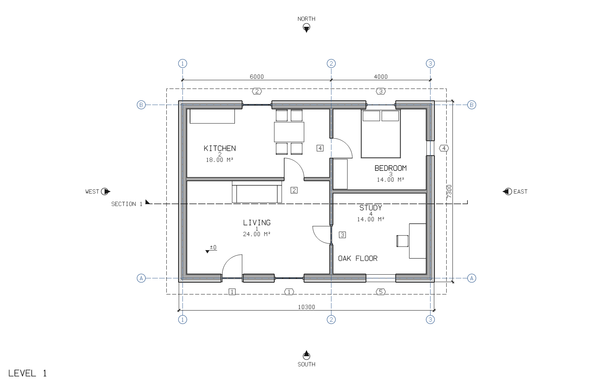
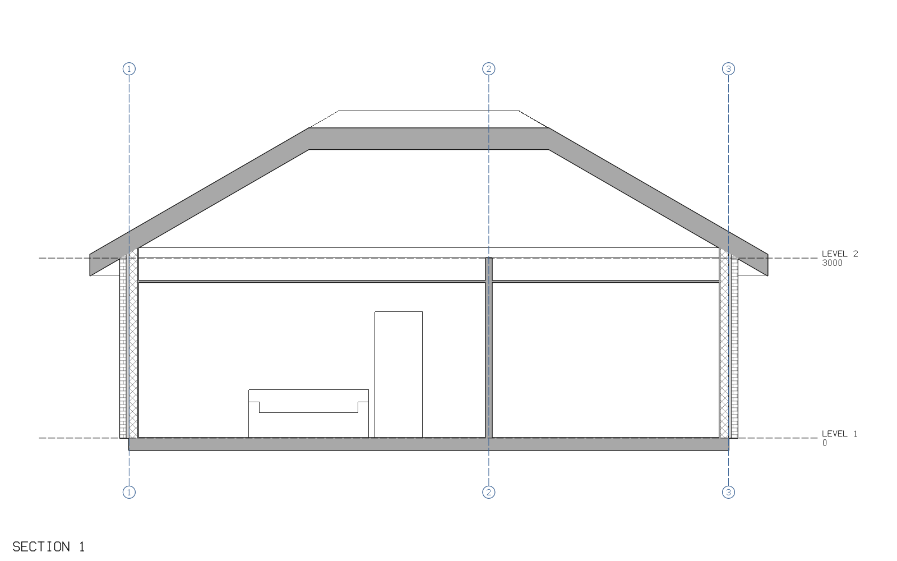
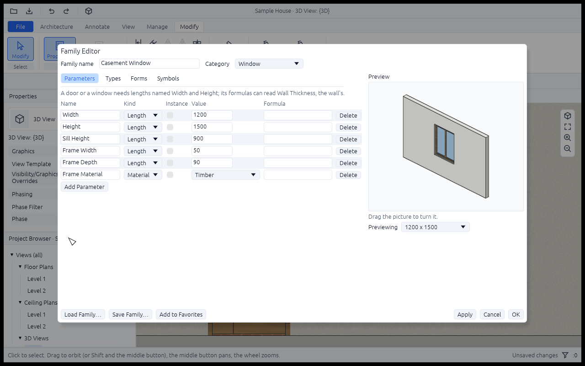
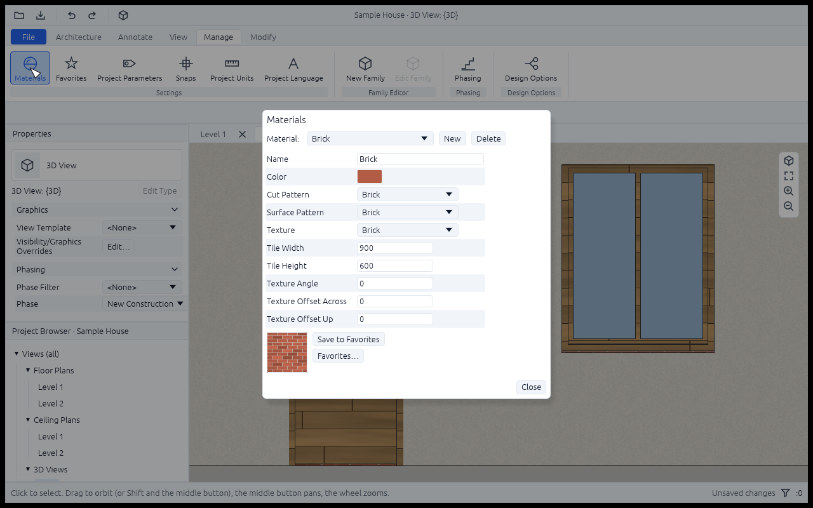

  

<h1 align="center">BIMCraft</h1>

  <b>用纯 Rust 从零实现的建筑信息建模（BIM）工作流，可被 AI agent 驱动。</b> 
  An open, clean-room take on the Revit workflow — every action is a command, so agents can drive it as well as you can.

  
  
  
  

  <a href="https://github.com/user-attachments/assets/46488109-fdc4-4ce5-a6bd-92b3b95af16c">▶ 34 秒演示：58 行文本建出一栋房子</a>

https://github.com/user-attachments/assets/46488109-fdc4-4ce5-a6bd-92b3b95af16c

> 演示内容：用 58 行文本命令建出样板房，生成平面/剖面/图纸/3D 视图，移动一面墙让门窗和房间面积跟着走，IFC 导入再导出，最后由 AI agent 通过 MCP 再建一栋。

---

## 这是什么

BIMCraft 是一个**独立的 BIM 桌面软件**，目标是把 Revit 那套工作流——楼层、墙、门窗、楼板、天花板、房间、柱、楼梯、坡道、栏杆、屋顶、洞口，以及从模型出平面图、剖面图、立面图、3D 视图、图框和明细表——用纯 Rust 重新实现一遍。

它不是一个插件，也不是一个脚本集合。它有自己的几何内核、渲染器、族系统、IFC 读写、桌面界面、命令行、MCP 服务器和自动更新器。

**关键设计：所有操作都是一条命令。** 桌面点按钮、CLI 跑脚本、AI agent 通过 MCP 调用，走的是同一套命令。这让它天然适合被自动化，而不是只能靠人手点。

## 截图

| 桌面界面（深色） | 样板房 3D |
|---|---|
|  |  |

| 平面图 | 剖面图 |
|---|---|
|  |  |

| 族编辑器 | 材质 |
|---|---|
|  |  |

## 已经能做什么

- **熟悉的工作流**：Ribbon、上下文 Modify 选项卡、Options Bar、属性面板（类型选择器、编辑类型）、项目浏览器、视图标签、Revit 快捷键（WA、DR、WN、RM、CL、DI、TG、MV、CO、RO、MM、AL、TR、SL、ME、CS、SA、VV、EH、MS、WB、FB、RB、UF、MH、KS）
- **真实的建筑模型**：门窗宿主在墙体里，房间从周围墙体自动找边界，墙角相连后移动一面墙仍保持连接，尺寸和标记跟随它们测量和命名的对象
- **出图**：平面、反射天花板平面、剖面、立面，可导出 SVG/PNG，带裁剪区域、线型和材质填充
- **图纸与明细表**：图框、视图按比例摆放、明细表字段/计算公式/筛选/排序/分组/合计，导出 CSV 或 XLSX
- **IFC**：IFC2x3 / IFC4 导入导出，每个构件都从几何反算尺寸
- **族系统**：参数、公式、类型、拉伸/旋转实体、开洞；门窗作为族宿主在墙里；自带图库
- **材质与表现**：程序化图案、PNG/JPEG 贴图按真实尺寸铺设、面级油漆、可见性与图形替换、视图过滤器、视图模板、阶段与设计选项
- **结构与 MEP**：柱、梁、基础、结构楼板；给排水、电气、防雷、数据四个选项卡和统一放置工具
- **3D 硬件加速**：Vulkan / Metal / DirectX 12，一张 20 层 9521 构件的高层，换帧 1.3ms（RTX 3060），软件渲染 108ms，失败时自动回退
- **Agent 驱动**：`bimcraft-cli` 提供 `run`、`info`、`convert`、`commands` 和 MCP server；模型可被脚本和 agent 完全驱动

## 工程上的几个硬约束

这个项目在工程纪律上做了很明确的选择，不是"能跑就行"：

- **生产代码不 panic**：`unwrap`、`expect`、`panic!` 是 lint 错误，`unsafe` 被禁止
- **所有输入都当敌意输入处理**：一条命令失败或 panic，模型保持原样，不会留下半截状态
- **核心与界面解耦**：核心不知道 UI 的存在，egui 前端只读模型、发命令，换一个前端也能跑
- **同一套绘制列表**：画布、PNG 导出、SVG 导出画的是同一份显示列表，所见即所得
- **Revit 文件读取**独立成 crate，核心不依赖它，版权和许可边界清晰

## 技术栈

Rust · egui · 自研几何内核与 CSG · 自研 2D/3D 渲染（Vulkan/Metal/DX12）· IFC（ISO 10303-21）· MCP · 跨平台打包（Windows MSI / macOS app / Linux AppImage）· 自动更新器

## 为什么做这个

建筑行业的 BIM 工具长期被少数厂商垄断，格式封闭、扩展困难、自动化能力弱。而 AI agent 已经能写代码、能操作软件，却缺少一个**可被程序完整驱动**的建筑建模内核。

BIMCraft 的假设是：如果建模软件的每一个动作本来就是命令，那么 agent 和人就能用同一种方式使用它——人点按钮，agent 发命令，脚本批量生成。这个假设在原型里已经跑通。

## 当前状态

- 早期开发阶段，核心建模、出图、IFC、族、材质、结构/MEP 基础已可用
- 桌面应用可在 Windows / macOS / Linux 构建
- **源码暂未公开**，可预约演示或洽谈合作
- 路线图：锁定/相等尺寸、阵列与组、自定义填充图案、DXF/DWG 导出、更完整的 IFC 与 gbXML、结构剩余部分、场地与体量、多人协同、签名安装包

## 合作

如果你在建筑设计院、施工单位、造价咨询或 BIM 软件公司，想验证"AI agent 直接驱动建筑模型"这条路径，或者需要定制化的 BIM 工具，欢迎通过 GitHub 联系。

## 声明

BIMCraft 是独立实现的 clean-room 项目，与 Autodesk 无任何关联，不使用 Autodesk 的代码、二进制或 `.rfa` 资源。Revit 是 Autodesk 的商标，此处仅用于描述工作流。项目目前为早期开发版本，不提供任何担保。
